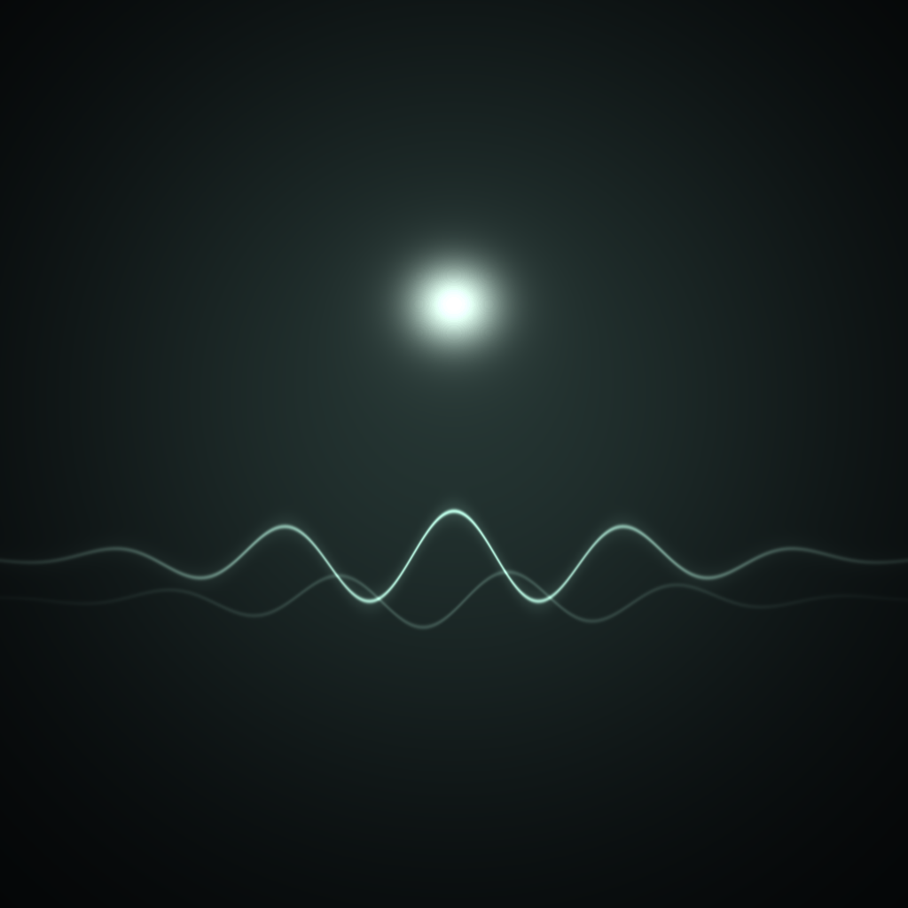
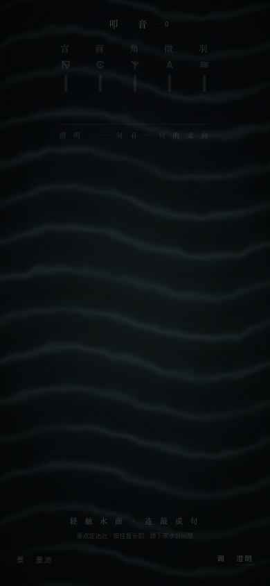
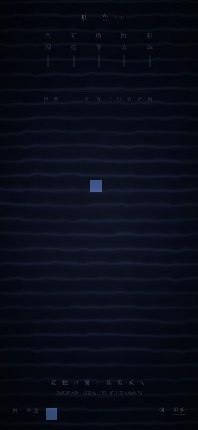
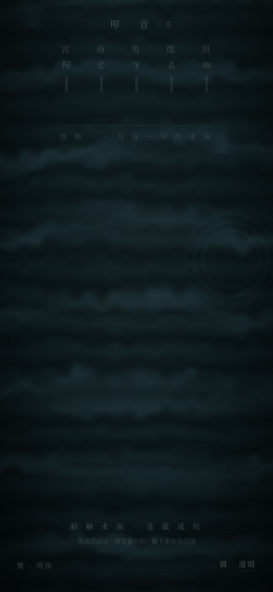
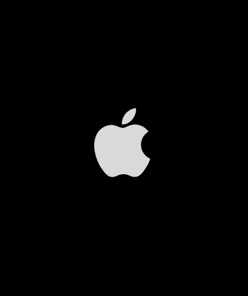

<div align="center">



# 叩音 · Stillwave

**一池水，一句曲。落指即音，连敲成句。**

一个开源的 iOS + watchOS 解压 App：单手轻叩屏幕，叩出宫商角徵羽五声音阶，
水面绽开涟漪，腕上响起触觉——**把压力敲进水里**。

[](https://github.com/ipgtzuo/stillwave/actions/workflows/ci.yml)
[](LICENSE)
[](#快速开始)
[](#三端架构)
[](CONTRIBUTING.md)
[](https://github.com/ipgtzuo/stillwave/stargazers)

*English intro below · [中文文档](#快速开始)*

</div>

---

<div align="center">
&nbsp;&nbsp;
&nbsp;&nbsp;
&nbsp;&nbsp;

</div>

> 左起：墨池 · 星潭 · 雨夜（雨夜 = 「夜雨落池」：天也在叩水），最右：Apple Watch 端。

## 为什么做叩音

压力大的时候，人需要的是**几秒钟、不用想、单手就能做**的小事。
叩音把这件事做成「叩水」：随机而有曲调的五音、温柔跟随的触感、安静的水面。
带在手腕上，开会中途、通勤路上，压力上来的那 30 秒，抬腕敲几下。

- **随机，但有曲调**：不是乱敲——旋律游走算法（MelodyWalk）让每次叩击落在
  听起来「对」的下一个音上，连敲自然成句
- **叩完，水会回想**：一句敲完稍等，水面会把你刚敲的句子用更轻更疏的触觉重播一遍
- **腕上无声**：手表端默认静音，曲调完全由**敲击疏密**编码成触觉（108→234ms 间隔），
  熄屏后靠正念会话（mindfulness session）继续

## 五套景 · 四种心境

| 景 | 语言 |
|---|---|
| 墨池 | 暗色水面 + 月光，叩击处绽开涟漪环 |
| 星潭 | 夜空星光落入深潭 |
| 宣纸 | 水墨在纸上化开 |
| 雨夜 | **夜雨落池**——雨点敲在水面绽开小涟漪，灯光倒影拉成颤动的光带，天也在叩水 |
| 松雾 | 大尺度雾带横向平移 |

心境（澄明 / 澄澈 / 沉潜 / 雨巷……）控制旋律的轮廓：音区、游走范围、句长、收束方式。

## 三端架构

不是把同一个界面缩放两遍——两端共享同一套五音律与心境规则，输出各用所长：

| | iPhone | Apple Watch |
|---|---|---|
| 视觉 | WKWebView 承载 WebGL 水面（`soft-tap.html`） | SwiftUI Canvas 原生重绘同一套视觉语言 |
| 触觉 | Core Haptics：intensity / sharpness / attack / decay 全可调 | `WKInterfaceDevice.play`：曲调由敲击疏密编码 |
| 声音 | 可选（默认关），五音合成 + 离线混响，不依赖音频资源 | 默认关闭，静音优先 |
| 后台 | — | `WKExtendedRuntimeSession(.mindfulness)` 熄屏续敲 |

详细设计与踩坑记录见 [docs/ARCHITECTURE.md](docs/ARCHITECTURE.md)。

## 快速开始

### 方式一：网页原型（零依赖）

`soft-tap.html` 是全部视觉与交互的源头，浏览器直接打开即玩（手机浏览器体验最佳）。

### 方式二：编译 iOS / watchOS App

需要 Xcode 16+（工程 objectVersion 77，本机用 Xcode 27.2 验证，双端 0 warning）：

```bash
git clone https://github.com/ipgtzuo/stillwave.git
cd stillwave/KouShui
open KouShui.xcodeproj    # 选自己的 Team 后 ⌘R，先跑模拟器
```

**免费 Apple ID 即可装真机**（不用付费开发者账号）：

```bash
cd KouShui
./scripts/install-device.sh    # 编译 → 装到 USB 连接的 iPhone → 启动
```

首次使用需：Xcode 登录 Apple ID、iPhone 打开开发者模式、信任证书。
完整排错见 [KouShui/AppStore/06-真机试装.md](KouShui/AppStore/06-真机试装.md)。

## 目录结构

```
stillwave/
├── soft-tap.html            网页原型（视觉源头，浏览器直接打开）
├── KouShui/                 Xcode 工程（iOS + watchOS 双 target）
│   ├── project.yml          XcodeGen 定义（可复现工程）
│   ├── Shared/              双端共享：五音律、心境、五景、合成器、墨符
│   ├── iOS/                 WKWebView 容器 + Core Haptics 桥接
│   ├── WatchApp/            表端引擎 + 触觉乐谱 + 熄屏会话
│   ├── AppStore/            上架材料（文案 / 审核 / 流程 / 截图脚本）
│   └── scripts/             真机一键安装脚本
├── docs/                    架构文档与截图
└── make_icons.py            图标生成脚本
```

## 参与贡献

欢迎任何形式的参与——见 [CONTRIBUTING.md](CONTRIBUTING.md)。特别欢迎：

- 🎨 **新的「景」**：shader + SwiftUI Canvas 双端各一份，参考现有五景
- 🎵 **新的心境**：改 MelodyWalk 的轮廓参数就能造一种曲风
- 🌍 **本地化**：目前只有中文界面，英文文案待补
- ⌚ **触觉手感**：Watch 端疏密编码的节奏还有很大打磨空间
- 📱 iPad / macOS Catalyst 适配

## 路线图

- [ ] English localization
- [ ] 自定义五音音阶（替换宫商角徵羽为任意五音）
- [ ] 敲击句子的导出 / 分享卡片
- [ ] 上架 App Store（材料已备齐，见 KouShui/AppStore/）

## 协议

[MIT](LICENSE) —— 自由使用、修改、商用，请保留版权声明。
App 名称「叩音 / Stillwave」与图标的使用请遵循署名礼仪，不要用于冒名发布。

---

<div align="center">

**叩音**取自《文赋》「叩寂寞而求音」——在寂静上敲，敲出声音来。

If this project helps you breathe easier, consider giving it a ⭐.

</div>
